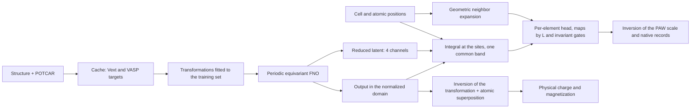

# CHON: review and benchmark of `ext2paw`

The experiment uses the **432 materials** in `data/CHON`, without including the
isolated atoms in the training set. The C, H, N and O references in
`data/CHON/isolated_atoms` define the atomic superposition for the residual
target. The benchmark keeps the magnetization and the complete PAW records.

## Final results

**18 valid training runs, totaling 960 epochs,** were completed: twelve
configurations with 30 epochs and three configurations confirmed with 100 epochs
and two seeds. The control and the confirmations use the same split of
303/88/41 structures. Runs that predate the integration fix do not enter these
numbers.

The confirmed recommendation uses **learning rate 0.003, `neighbor_min: 0.6`,
width 16, three layers, six modes and eight radial functions**, with PAW weight
3 and residual density relative to the atomic references. Charge and
magnetization remain present. It was not necessary to increase the number of
parameters: 60,118.

| Configuration, 100 epochs | Validation charge L2 (%) | Validation PAW RMS (%) | Common score |
| --- | ---: | ---: | ---: |
| Control | 8.693 ± 0.411 | 10.111 ± 0.563 | 1.732 ± 0.045 |
| Learning rate 0.003 only | 8.814 ± 0.323 | 10.033 ± 0.251 | 1.642 ± 0.047 |
| Short neighbors + learning rate 0.003 | **8.330 ± 0.249** | **6.382 ± 0.261** | **1.368 ± 0.052** |

The deviations are across **two initializations**; they are not confidence
intervals or cross-validation results. The mean reduction in PAW error relative
to the control is **36.9%**; that in charge error is **4.2%**. The score
improvement is 21.0%.
[Full confirmation table](results/confirmation_all/table.md) and
[curves in PDF](results/confirmation_all/benchmark.pdf).

The test set was opened only after selection by mean validation, and only for
the winning configuration. The 41 test structures gave:

| Initialization | Charge L2 (%) | PAW RMS (%) |
| --- | ---: | ---: |
| 0 | 7.961 | 5.287 |
| 1, checkpoint chosen by validation | 8.273 | 4.588 |
| Mean ± deviation across initializations | **8.117 ± 0.220** | **4.938 ± 0.494** |

The exported bundle is [results/final/best.poraque](results/final/best.poraque),
from seed 1, epoch 65; the other initialization restored epoch 45. The
[recommended configuration](../../configs/train_ext2paw_chon_best.yaml) stores
the hyperparameters and the explicit common band. The general CLI uses its own
split; to reproduce the held-out test, use the runner and the commands below.
The [selection record](results/final/selection.json), the
[complete test metrics](results/final/test_winner.json) and the
[worst cases per structure](results/final/error_distribution.json) are
available.

On the test set, the atomic superposition alone has a mean charge error of
10.693%, and the PAW mean fitted to the training set has an RMS of 20.732%.
These are baselines; the FNO control was compared on validation and was not
additionally evaluated on the test set. The raw mean error of the winner's
electron count is 1.482%, without correction.

The **magnetization remains poorly predicted**, with a pooled error of 99.374%
on the test set. The aggregate PAW RMS also does not summarize the accuracy of
each multipole: in the exported checkpoint, C has charge errors of 45.96% in L1
and 38.11% in L2. The blocks by element, set and L are in `test_winner.json`.
The recommendation improves the measured task, but does not yet validate a
magnetic restart, all-electron density, energy, forces or VASP SCF convergence.

Inference with the final bundle was verified on `mp-1212522`, from the
validation set: H₁₀C₄N₆O₆, grid 8×10×24, two channels and **52 PAW records**.
Each set has 15 values per H and 33 per C/N/O. The fields are finite and the
records come from the model, without normalizing the electron count. The
[export verification](results/final/inference_smoke/verification.json) records
these checks. The 109 schema checks, including the recommended configuration,
passed.

## DFT × model parity plots

The plots for the final checkpoint are in **`results/final/plots/`**:

- [Density: training and validation](results/final/plots/ext2paw_parity.png).
- [Density: held-out test](results/final/plots/ext2paw_parity_test.png).
- [PAW occupancies: training and validation](results/final/plots/ext2paw_parity_paw.png).
- [PAW occupancies: test, by element and L](results/final/plots/ext2paw_parity_paw_blocks_test.png).
- [Magnetization: test](results/final/plots/ext2paw_parity_magnetization_test.png).

Each figure also has a PDF version; the histograms and bin limits are stored in
CSV. The comparison uses the DFT targets on the working mesh and the physical
predictions, restoring the transformations and the atomic superposition saved in
the bundle. The 303 training materials, 88 validation materials and 41 test
materials enter their respective plots. The checkpoint and the split remain
those chosen before these diagnostics; there was no new training and no new
selection by the test set.

The benchmark initially exported only curves and tables: its routine did not
call the parity report of the main CLI. `finalize.py` now generates the
winner's figures automatically; the recommended configuration also keeps the
CLI defaults for figure and report generation.
To regenerate only the plots of the existing checkpoint:

```bash
python experiments/chon_ext2paw/plot_parity.py
```

The density parity samples up to 10,000 voxels per structure with seed 42. The
annotated L2 pools those voxels into a single quotient; it therefore differs
from the mean of the per-structure errors used in the benchmark tables. On the
test set for the exported checkpoint, they are 7.144% in the parity plot and
8.273% in the per-structure mean.
The logarithmic figures show only positive pairs. The versions
`ext2paw_parity_charge_linear_validation` and `ext2paw_parity_charge_linear_test`
include the negative values, without clipping. Counts, positive fractions,
metrics and the SHA-256 of the checkpoint are in
[parity_metadata.json](results/final/plots/parity_metadata.json).
The PAW parity plots use all valid native components, without the batch padding;
the errors of the 12 charge blocks of the test set were checked against the
original metrics.

## Screening results

With 30 epochs, initialization seed 0 and the same 88 validation structures,
the combined arm with `neighbor_min: 0.6` and learning rate 0.003 reached
**8.379% relative charge L2 and 6.768% PAW RMS**. The control had 8.586% and
10.900%. The PAW error reduction is 37.9%; the common balanced score falls from
1.868 to 1.463. These are screening numbers; the two-seed confirmation and the
test are above.
The [consolidated table](results/screen_all/table.md) and the
[curves and accuracy comparison](results/screen_all/benchmark.pdf) gather the
stages.

The multipolar charge gains, in percent, are below. The field magnetization
still has a pooled relative error of 99.46% in the combined arm.

| Element | L0: control → combined | L1: control → combined | L2: control → combined |
| --- | ---: | ---: | ---: |
| H | 5.55 → 3.81 | 34.85 → 7.32 | 47.25 → 12.75 |
| C | 6.28 → 3.92 | 65.24 → 48.73 | 59.17 → 37.18 |
| N | 5.90 → 3.05 | 40.52 → 14.42 | 64.45 → 42.25 |
| O | 3.18 → 1.96 | 33.60 → 17.02 | 65.29 → 44.70 |

## Reproducible run

From the repository root:

```bash
python experiments/chon_ext2paw/prepare.py
python experiments/chon_ext2paw/benchmark.py --epochs 30 --seeds 0 --threads 2 \
  --arms baseline lr_low lr_high width32 width64 layers5 modes10 radial16 occ1 absolute \
  --output experiments/chon_ext2paw/results/screen
```

`--pilot` uses the first 48 available structures, serves only to measure cost
and does not evaluate the test set. The confirmation uses 100 epochs and two
initializations per configuration, including the control for a comparison with
the same budget:

```bash
python experiments/chon_ext2paw/benchmark.py --epochs 100 --seeds 0 1 --threads 2 \
  --arms baseline --output experiments/chon_ext2paw/results/confirmation
python experiments/chon_ext2paw/benchmark.py --epochs 100 --seeds 0 1 --threads 1 \
  --arms lr_high --output experiments/chon_ext2paw/results/confirmation_lr_high
python experiments/chon_ext2paw/benchmark.py --epochs 100 --seeds 0 --threads 1 \
  --arms short_neighbors_lr_high --output experiments/chon_ext2paw/results/confirmation_geometry
python experiments/chon_ext2paw/benchmark.py --epochs 100 --seeds 1 --threads 1 \
  --arms short_neighbors_lr_high --output experiments/chon_ext2paw/results/confirmation_geometry_seed1
# Run only when all the confirmations are complete.
python experiments/chon_ext2paw/finalize.py \
  experiments/chon_ext2paw/results/confirmation \
  experiments/chon_ext2paw/results/confirmation_lr_high \
  experiments/chon_ext2paw/results/confirmation_geometry \
  experiments/chon_ext2paw/results/confirmation_geometry_seed1
```

The test set does not take part in the ranking. `finalize.py` refuses a second
evaluation when `test_winner.json` already exists. To repeat the benchmark with
another revision of the code, use new output directories; the signatures verify
the implementation. The two geometric seeds were run in independent processes.

The additional geometric arm tests radial neighbor centers from 0.6 to 5.8 Å,
instead of the 2.2 to 5.8 Å used in the earlier study with Pt. It keeps ten
channels, a 6 Å cutoff and a Gaussian width of 0.3 Å. The earlier centers
barely respond to the short CHON bonds: for example, the first Gaussian has a
radial weight close to 0.0012 at 1.1 Å. The checkpoint stores the centers as
buffers; a round-trip test confirms identical PAW predictions after loading.
The overrides and effective centers are also stored in `metrics.json`.

```bash
python experiments/chon_ext2paw/benchmark.py --epochs 30 --seeds 0 --threads 1 \
  --arms short_neighbors --output experiments/chon_ext2paw/results/geometry
python experiments/chon_ext2paw/benchmark.py --epochs 30 --seeds 0 --threads 1 \
  --arms short_neighbors_lr_high --output experiments/chon_ext2paw/results/geometry_joint
```

The setting is also available in the main CLI as `model.paw.neighbor_min`.
The default of 2.2 Å is preserved. Earlier models, including the geometric
prototype without this key in its metadata, restore their centers from the
buffers.

The stages keep their own fingerprints. `finalize.py` gathers confirmations with
the same epoch budget, the same two seeds and the same split, before evaluating
only the winning configuration on the test set. The times were measured with
simultaneous processes and different thread counts; they are observed costs of
these runs, not an isolated benchmark of hardware performance.

## Protocol

The control uses width 16, three layers, six modes, eight radial functions,
learning rate 0.001 and PAW weight 3. Each arm changes one parameter of the
control, except the combined arm indicated in the table. It is a controlled
screening of twelve configurations, without claiming a global optimum in the
hyperparameter space.

| Arm | Change relative to the control |
| --- | --- |
| `baseline` | None |
| `lr_low`, `lr_high` | Learning rate 0.0003 or 0.003 |
| `width32`, `width64` | Width 32 or 64 |
| `layers5` | Five layers |
| `modes10` | Ten modes; automatic radial band resolved again |
| `radial16` | Sixteen radial functions |
| `occ1` | PAW weight 1 |
| `absolute` | Absolute density prediction, without atomic superposition |
| `short_neighbors` | First radial center at 0.6 Å |
| `short_neighbors_lr_high` | First center at 0.6 Å and learning rate 0.003 |

- Split by **whole structures**, stratified by the set of elements, with seed
  42: 303 training, 88 validation and 41 test. Very small groups stay in the
  training set. This measures interpolation between structures, not
  extrapolation to new elements or validation by entirely excluded chemical
  families.
- Normalizations of the fields and of the occupancies fitted to the training set
  only. The reference PAW mean is also computed from training atoms only.
- Common readout band determined by the geometric compatibility of the grids,
  without fitting target statistics: **2.239577 Å⁻¹** at resolution 24.
  It is a geometric restriction known for this domain, including the held-out
  grids. The model cannot require a frequency that is absent from a structure.
- The best checkpoint of each run follows its own objective function.
  The ranking across configurations uses **the same** criterion:
  `physical charge relative L2 + 3 × balanced normalized PAW loss`.
  This allows different PAW weights to be compared without rewarding a lower
  weight merely because it decreased the scale of the score.
- Physical PAW error accumulated over the atoms, also separated by element,
  charge/magnetization set and L. Density error averaged over structures.
  No clipping of negative values or adjustment of the electron count enters the
  metrics: these operations would hide part of the error.
- Same materials, initialization and epoch budget across the controls.
  A second initialization must confirm the finalists; error across seeds is not
  equivalent to cross-validation uncertainty.

The files `split.json`, `audit.json`, resolved configurations, history,
per-structure/block metrics, CSV and checkpoints make the result verifiable. The
`.poraque` weights remain local, as per the project's `.gitignore`. A run with
complete metrics is resumed only if the configuration, the split and the
fingerprint of the atomic references coincide.
The Python code of the implementation and of the runner also enters the
signature.

## Fix to the integration of the PAW kernels

CHON exposed a defect that the earlier high-band set did not exercise: resolving
the field on a mesh does not guarantee resolving the kernel used to integrate
it. At the common band of 2.239577 Å⁻¹, the old quadrature used a spacing close
to 0.70 Å, whereas the narrowest Gaussian has a width of 0.20 Å. A constant
field produced different features for atoms at distinct positions and L > 0
components that should be exactly zero.

The implementation now uses the angular identity
`∫ exp(i G·r) Y_LM(r̂) dΩ = 4π i^L j_L(Gr) Y_LM(Ĝ)` and integrates the radial
part with 128 Gauss-Legendre points. This preserves the smooth cutoff and avoids
artificially large meshes. The kernels depend only on the geometry and are kept
in a cache limited to 64 MiB per readout. The fields and the atomic phases
remain in autograd. The cell is fixed geometry on this path. Above
6.283185 Å⁻¹, the spacing already resolves the kernels and the earlier spatial
quadrature remains.

In `results/readout_validation.json`, the L0 error for a constant field falls
from 9.02% to 4.11×10⁻¹⁵ in double precision. The spurious L1 and L2 norms fall
from 0.642 and 0.897 to zero. Independent tests verify the integral of a field
of plane waves, invariance to the grid, rotation, gradients of the fields and
positions, as well as training on CPU and Metal.

The runs that predate the fix were preserved in `results/legacy_quadrature`
and **do not take part in the selection**. Old models trained in this low-band
regime need to be retrained: the fix changes the features supplied to the head.

## Data audit

There are **13,225 atoms**: H 4,525, C 3,112, N 2,754 and O 2,834. All the
records verified in the cache have 15 components for H and 33 for C/N/O,
consistent with the projectors of the POTCAR library. The POTCARs of the
isolated atoms are identical, by SHA-256, to the corresponding ones used to
build the potentials. This compatibility does not prove the identity of the
original Materials Project POTCARs, whose files do not accompany the download.

The electron counts of the 432 targets also agree with the valence charges of
the C/H/N/O references: the largest relative difference is 2.88×10⁻⁷. This
verifies valence compatibility, not identity of the radial potentials. The
per-material values are in `results/electron_count_audit.json`.

An additional geometry check, with cell and fractional positions sorted and
rounded to six places, found no exact duplicates. It does not rule out
equivalences under another cell basis or very close structures.

The HDF5 cache occupies approximately 112 MiB and has 83 grid shapes. The
truncation at resolution 24 leaves 4.06% of the charge points negative from
spectral oscillation. The magnetization norm is 5.20% of the charge norm.
Therefore, eliminating the magnetization would change the problem, and
requiring positivity of the truncated field would also alter the target. The
accuracy here is the accuracy on the **truncated field**, not on all the modes
of the native CHGCAR.

An additional audit of **12 validation structures**, covering quantiles of the
number of atoms, measures the effect of the truncation against the native
CHGCARs. It is a descriptive sample, without using the held-out test set, and is
not a high-resolution training. To repeat it:
`python experiments/chon_ext2paw/resolution_audit.py`.

| Maximum resolution | Native charge projection: mean error | Residual-only projection, restoring the native atomic reference |
| --- | ---: | ---: |
| 24 | 7.444% | 2.968% |
| 32 | 2.753% | 1.495% |
| 48 | 0.687% | 0.375% |
| 64 | 0.153% | 0.064% |

The last column measures the representation error relative to the norm of the
absolute charge, assuming an exact coarse residual. It is not a measured
inference error and is not a guarantee about native FNO predictions. The atomic
superposition can restore content that a simple upsample of the truncated charge
would lose. In the large structures, grid 24 may limit the native accuracy; the
validation and test numbers of the main benchmark remain referred to grid 24.
Details per material are in `results/resolution_audit.json`.

The CHGCAR stores both the field and the occupancies of a center; the additional
magnetization blocks and the `LMAXMIX` limit also need to be preserved for a
restart. [VASP documentation](https://vasp.at/wiki/CHGCAR).

## Review of the code path



| Component | Role and assessment |
| --- | --- |
| `fields/vasp`, `fields/hdf5` | Reading of the density, geometry, spin channels and occupancies; HDF5 preserves the records without truncating them along with the grid. |
| `data/sources.py`, `data/cache.py` | Discovery of the calculations, external potential derived from the POTCARs and cache with build provenance. The benchmark requires POTCARs and does not admit a Gaussian fallback. |
| `fields/atomic.py` | Independent references and radial form factors; the superposition enters the residual target and is restored in the physical prediction. |
| `ml/data.py` | Batches by grid shape, padding of atoms and components, and fitting of the normalizations on the training set. This split is essential to avoid target leakage. |
| `ml/fno.py` | Periodic scalar operator, physical truncation, radial filters and conditioning by the cell. Modes, radial basis, width and depth have different effects on capacity and cost. |
| `ml/paw.py` | Reading of the field and of the latent around each atom, neighbor expansion and per-element head with angular-momentum blocks. The scale is shared across M components to preserve the tensor transformation. |
| `ml/training.py` | Joint optimization, physical metrics and restoration of the best model. The PAW loss gives similar weight to each L block; the raw RMS, alone, can hide multipolar and magnetic errors. |
| `scripts/poraque_train.py` | Assembly of the task and resolution of the architecture. `model.paw` determines the `ext2paw` backbone, including the modes used to resolve the radial basis. |
| `scripts/poraque_inference.py` | Uses the bundle's PAW operator to generate records when requested. The heads are per element, and coverage of elements that were not trained should not be assumed. |
| `physics`, `calculator.py` | Energy and forces are consumers of the predictions; this benchmark does not validate their accuracy or a VASP SCF/restart run. |

The observable problems that were fixed include:

1. H-only batches had targets with 15 values and output with 33: the loss and the
   RMS now align the batch length with that of the output, preserving the padding
   mask.
2. The volume in the readout was computed by `linalg.det` on Metal, an operation
   not implemented in the local PyTorch. The computation uses the framework's
   volume helper.
3. The complex indexing of the readout failed in the Metal backward pass. The
   copy of the coefficients now uses a real representation with two components,
   keeping the complex FFT and the gradient.
4. Elongated cells could produce `2×2×24` grids, impossible for the truncation
   that discards Nyquist. The reduced size keeps at least four points per axis,
   without enlarging an axis that was originally smaller.
5. The inference CLI required `ext2chg` and `chg2tau`, even for a bundle
   containing only `ext2paw`. It now uses the density output of the PAW operator
   and writes its records, omitting TAUCAR and energy when there is no kinetic
   operator. Comparison and figures also handle this absence. The training CLI
   accepts `--task ext2paw` directly.
6. The quadrature of the PAW kernels was insufficient at low bands, introducing
   position and multipole errors in constant fields. The spectral path corrects
   this integral without altering the quadrature already used at high bands.

The resolution of `g_basis: auto` and its reporting were also fixed: both must
follow the modes of the PAW backbone, instead of using `model.modes` when the two
values differ. This is relevant for the band comparison.

## Limitations found

`ext2paw` does not yet accept the `--kfold` path or the CLI's fine-tuning. The
confirmation by seeds in this experiment does not replace these capabilities.
The aggregates also give different weights to structures and atoms; for this
reason the report keeps both metrics.

The training uses AdamW, decay 10⁻⁴, cosine scheduler and gradient clip 1.
The data term is relative L2 on the normalized field; in the residual
configuration, it emphasizes the correction to the atomic superposition. The
validation restores the absolute charge and keeps the magnetization. Additional
physical terms are disabled in this control. Mixing numbers from the normalized
loss with physical errors would give an incorrect comparison. The batches are
grouped by grid shape: all the materials are seen once per epoch, but incomplete
batches receive a whole optimization step. This limits the interpretation of
cost and effective weight per structure when there are many distinct shapes.

The magnetization error deserves its own interpretation. The audit in
`results/screen/spin_audit.json` finds 65 structures with positive net moment,
18 with negative and 349 with net moment close to zero, although only 137 have a
practically null magnetic field. The scalar potential does not convey a spin
orientation or a choice among magnetic states. A global spin convention or
conditioning on the magnetic state may be necessary; this analysis does not alter
the signs of the targets to reduce the error. Predicting zero magnetization has a
relative error of 100% for a nonzero target: numbers close to this value do not
demonstrate that the model learned the magnetization.

A diagnostic of the exported checkpoint confirms **amplitude suppression**:
the pooled norms of the predicted magnetization are 3.39% of the DFT norm on
training, 4.50% on validation and only 1.80% on the test set. Allowing an
independent global spin inversion per structure changes the test error from
99.507255% to 99.507223%. Therefore, the error of this checkpoint is not mainly
explained by a global sign swap. This calculation is only diagnostic: the
targets, the selection and the original metrics were not modified.

In 365 of the 432 structures, `||m||/||rho|| < 10^-4`. The relative field loss
concatenates the two channels before computing the norm, instead of normalizing
their magnetic error independently. Both asinh channels also use the same scale,
0.0192918, fitted to the training charge residual. This choice avoids magnetic
scales determined by noise, but does not balance the channels. On the training
set, the magnetization represents on average 5.31% of the squared norm of the
normalized target; the median of this fraction is only 3.33×10⁻⁸. This imbalance
is compatible with the observed collapse, although a per-channel weight benchmark
is necessary to measure its effect causally.

VASP can also converge to different magnetic states depending on the
initialization, described in [MAGMOM](https://vasp.at/wiki/index.php/MAGMOM).
This information is not supplied to the current FNO. A next comparison should
evaluate an explicit magnetic loss with a scale floor fitted to the training set
only, sampling of magnetic structures and a spin convention or input that
specifies the magnetic configuration. A null total moment, by itself, does not
prove a null local field: antiferromagnetic states can also have a zero integral.

The diagnostic refers to the **field on the mesh**. The PAW occupancy head is
distinct: in the exported checkpoint, the coefficients of the PAW magnetic set
have a pooled RMS of 29.20% on the test set, whereas the magnetic field has an L2
of 99.51%. The two predictions have no magnetic consistency imposed by this
benchmark. The complete numbers are in
[magnetization_diagnosis.json](results/final/magnetization_diagnosis.json),
and the PAW statistic in `results/final/plots/parity_metadata.json`.

The cache verifies build parameters and the origin of the POTCARs, but does not
compute a hash of each CHGCAR to automatically invalidate files altered at the
same path. Altering the native data requires building a new cache. The PAW mean
of the whole set is not used in this benchmark.

The geometric neighbor expansion of the current head does not separate the
element of each neighbor. The additional chemical information comes from the
fields and from the head of the central element. Enriching this expansion is a
possible architectural change, still unmeasured in this experiment.

The field supplied to the PAW head is the backbone output **in the training
domain**, alongside the reduced latent. The inversion of the transformation and
the restoration of the atomic superposition happen in the wrapper for the
physical prediction. Therefore, in the residual experiment with asinh, this
channel is not directly the pseudo absolute density in e/ų. The linear
correlation measured with the original DFT density cannot be automatically
transferred to this channel. Comparing a reading of the reconstructed physical
density is another possible architectural change, still without a benchmark here.

Two spectral limits deserve a specific next comparison. First, `g_basis: auto`
chooses 4.427 Å⁻¹ in the control, and 38.7% of the retained modes lie above this
limit, sharing the last radial function. Increasing only `n_radial` does not
widen this band; the `modes10` arm also resolves a new `g_basis`, consistent with
its modes. Second, a very elongated cell imposes 2.239577 Å⁻¹ on the common
readout, although a large part of the grids resolve larger bands. A resolution
defined by a minimum physical spacing, instead of limiting only the longest axis
to 24 points, may allow a wider common readout. This still needs training and a
controlled comparison; the resolution audit measures only the truncation of the
targets.

In the last general suite without tests marked GPU: **2,231 passed, 101 were
skipped and 27 deselected; 16 failed**. Fifteen failures are from
`test_badges.py`, after the editing of the badges in commit `8e1c2b8`; the other
is `test_vis.py::TestLogTickLabels::test_thins_the_minor_labels`, which was
already reproducible in isolation before the PAW fixes and depends on an
expectation about Matplotlib's default minor labels. None of these failures
involves training or PAW occupancies. The tests specific to the fixes, including
training/backward of an H batch on CPU and Metal, passed. The details are in
`results/validation.json`.
The inference test of an exclusively PAW bundle, together with the inference and
pipeline-defaults tests, also passed: 54 tests, 7 skipped.

After the spectral fix, 340 tests of the PAW path, devices, reading,
equivariance and inference passed; eight were skipped. The times per epoch for
the full set are recorded in the results. Pilots that predate the fix are not
used to compare the accuracy of the final models.
After exposing `neighbor_min`, another 262 tests of PAW, configuration, devices
and inference passed; seven were skipped. The checkpoint tests cover the new
metadata and the old format, for both sets of radial centers.
