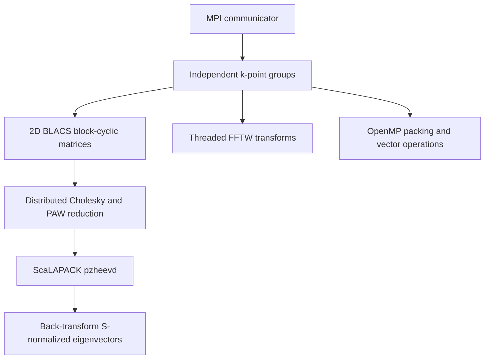

# Optional hybrid diagonalization backend

This directory contains original C11 code, public C interfaces, CMake build
rules and a ctypes binding. It includes no VASP code or potential data.

## Implemented architecture



MPI ranks split into equal groups of `ranks_per_k` (must divide communicator
size). A near-square BLACS grid in each group distributes matrix rows/columns
and the eigensolver work over bands. Assign distinct k tasks by
`range(backend.group, nk, backend.groups)`. Every rank in a group enters its
solver calls collectively; different groups work independently. Result reduction
across groups belongs to the calling MPI application. The existing Python
Harris mesh loop is not automatically transformed into this distributed driver.

Complex Hermitian matrices cover scalar, collinear and SOC Hamiltonians. PAW
requires `H c = epsilon S c`; ignoring S is incorrect. The implemented path is:

```
S = L L†                      (pzpotrf)
A = L^-1 H L^-†               (pzhegst)
A Z = Z epsilon               (pzheevd)
X = L^-† Z                    (pztrsm)
```

Eigenvectors are S-normalized. Failure of positive-definite overlap propagates
collectively. Root convenience calls scatter/gather block-cyclic pieces; the
advanced `pq_local_shape`/`pq_solve_local` interface accepts preassembled local
blocks, avoiding global matrix ingestion. Descriptors use column-major local
storage and LP64 integers; ILP64 libraries are unsupported by this ABI.

`pzheevd` computes **all** eigenpairs. The Python `nbands` argument slices the
result; it does not reduce cubic work. This is a dense reference backend, not
a linear-scaling method or an optimized partial-spectrum implementation.

## Build

Requires a C compiler, matching MPI/BLACS/ScaLAPACK, OpenMP, BLAS/LAPACK, and FFTW
with thread support. Do not mix MPI implementations or LP64/ILP64 libraries.

```bash
cmake -S src/poraque/hpc -B /tmp/poraque-hpc-build -DCMAKE_BUILD_TYPE=Release
cmake --build /tmp/poraque-hpc-build -j 4
```

If a vendor library is not found automatically, pass a semicolon-separated
`-DSCALAPACK_LIBRARIES=...` list with its LP64 ScaLAPACK, matching BLACS,
BLAS/LAPACK and runtime dependencies. The local validation used oneMKL's
`mkl_scalapack_lp64`, `mkl_blacs_openmpi_lp64`, `mkl_gf_lp64`, `mkl_sequential`,
and `mkl_core`. Threaded BLAS can replace sequential BLAS in a correctly matched
build; limit its thread count to avoid oversubscription. The tested OpenMP work
includes packing, scaling and threaded FFTW; the validation BLAS was sequential.
Some MPI wrappers need explicit `-DMPI_C_HEADER_DIR=<MPI include directory>`
when CMake discovery is incomplete.

## Python interface

```python
from poraque.hpc import ParallelEigensolver

# Run this program on every participating rank under mpiexec.
with ParallelEigensolver("/path/libporaque_hpc.so", ranks_per_k=2,
                         block=32, threads=2) as backend:
    for ik in range(backend.group, len(kpoints), backend.groups):
        H = S = None
        if backend.rank == 0:
            H, indices = hamiltonian.matrix(kpoints[ik])
            k = (kpoints[ik] + 0.5) % 1 - 0.5
            q = (indices + k) @ grid.reciprocal_cell
            S = hamiltonian.nonlocal_potential.overlap(q)
            # For a spinor H, use scipy.linalg.block_diag(S, S).
        result = backend.solve(H, S, nbands=24)
        if backend.rank == 0:
            consume(ik, result.eigenvalues, result.vectors)
```

`hamiltonian` may be obtained from `solver.evaluator.hamiltonian(solver.prediction)`;
the first returned item is its tuple of spin Hamiltonians. Collinear channels
are separate tasks; spinors are one doubled matrix. Root matrices are complex128
Fortran-order, copied before solving. Caller arrays are not mutated. Worker
ranks pass None and receive None; only the group root receives eigenpairs.
Without mpi4py, the library initializes MPI itself. With an external MPI runtime,
pass `communicator_f=comm.py2f()`; externally owned MPI is never finalized.

For the existing single-process Harris driver, opt in without changing its API:

```bash
PORAQUE_DIAGONALIZER_LIBRARY=/path/libporaque_hpc.so PORAQUE_HPC_THREADS=2 \
  python scripts/poraque_bloch.py calculation --models model.poraque \
  --potcar /licensed/inputs/POTCAR --output energy.json
```

This adapter refuses multi-rank launches to prevent duplicating the whole mesh.
Use the collective group API above for MPI jobs. A native H2 Harris run matched
the SciPy path within 5e-14 eV. There is no measured production speedup claim.

## FFTW and distributed FFT extension

`backend.fft(values, inverse=False)` uses threaded local FFTW with NumPy's
normalization convention. Planning/destruction and MPI calls originate only on
the main thread; OpenMP regions do not call MPI. MPI initialization requests
FUNNELED support. All FFTW-allocated buffers/plans are explicitly released.

`fft_mpi.c` additionally implements optional distributed slab transforms:
`pq_fft_slab_create`, `pq_fft_slab_data`, `pq_fft_slab_execute` and
`pq_fft_slab_destroy`. Build with `-DPORAQUE_FFTW_MPI=ON` only when FFTW MPI headers
and libraries are available. Use `pq_context_communicator` for a group's Fortran
communicator handle. Local slab dimensions/start and its buffer are returned;
callers populate/consume that distributed storage. Close slabs before contexts.
The MPI FFT extension was **not compiled or tested here**, because FFTW MPI
development headers/libraries are absent. It is explicit boilerplate, not an
emulated or silently enabled distributed transform.

## Memory, failures and practical scaling limits

- Every library-owned allocation has a matching free, including eigensolver
  workspaces and error paths. NumPy owns Python arrays; C never frees them.
- Collective allocation/validation failures are reduced before communication;
  invalid root matrices and indefinite overlap fail on every group rank.
- Root MPI counts are checked against INT_MAX and allocation products against
  size limits. Positive dimensions and queried workspaces are validated.
- Context close is collective and explicit; `__del__` never attempts MPI work.
  Shutdown finalizes only library-owned MPI after all contexts are closed.
- The root Python/scatter interface still needs O(N²) memory on its group root.
  Fully scalable construction requires writing H/S directly into local tiles.
  `pq_solve_local` supplies the solve interface; distributed PAW assembly and
  redistribution between FFT slabs and BLACS tiles remain application work.
- Full eigenvectors ultimately cost O(N²) globally, even with perfect
  distribution. Large systems may benefit from iterative/selected-spectrum
  methods; these are not implemented here.

The native backend does not yet replace PyTorch FFTs in the differentiable PBE
functional; preserving the energy/potential derivative requires an adjoint-aware
integration rather than a blind transform substitution.

## Validation

```bash
mpiexec -n 4 python tests/hpc_worker.py /path/libporaque_hpc.so
PORAQUE_HPC_TEST_LIBRARY=/path/libporaque_hpc.so pytest -q tests/test_hpc_backend.py
```

Actual four-rank/two-group tests covered dimensions 1, 3 and 13, ragged local
blocks, complex generalized eigenproblems, standard spectra, invalid root input,
indefinite overlaps, input preservation and forward/inverse FFTs. Maximum
SciPy eigenvalue error was 6.3e-15 eV; generalized residual was 1.6e-14 eV;
FFTW/NumPy discrepancy was 2.6e-15. This validates correctness on small matrices;
strong/weak scaling and large-node memory/performance remain unmeasured.

The implementation follows the [ScaLAPACK pzheevd interface](https://www.netlib.org/scalapack/explore-html/da/d75/pzheevd_8f.html)
and [generalized reduction](https://netlib.org/scalapack/explore-html/d4/d53/pzhegst_8f.html).
Threading/lifecycle conventions follow [FFTW MPI and threads](https://fftw.org/fftw3_doc/Combining-MPI-and-Threads.html)
and [FFTW thread safety](https://ftp.fftw.org/doc/Thread-safety.html).


A separate four-rank single-group run also tested a true 2x2 BLACS grid:
maximum eigenvalue discrepancy 4.0e-15 eV, generalized residual 1.9e-14 eV.

## Validated profiling

Use `python scripts/poraque_profile.py --help` for the kernel/scaling runner,
`python scripts/poraque_plot_profile.py results.csv --output scaling.png` for
plots, and [the methodology](../../../experiments/hpc_performance/README.md)
for timing scopes, the production ext2chg regression and interpretation.
`pq_profile` reports cumulative rank-local `MPI_Wtime()` durations reduced
with MAX over the k group. These are inclusive timers: `solve_root` contains
`solve_local`, which contains `pzheevd`; `fft_total` contains planning and
execution. Do not sum these slots. Failed operations do not provide meaningful
profiles. Reset timers collectively after validation and warmup.

The new root-local `pq_assemble` OpenMP kernel computes
`H = Vlocal + diag(T) + B D B†`, with arbitrary complex Hermitian `D` (including
spinor projector couplings). It consumes prepared matrices. Projector
construction, local-potential Fourier indexing, overlap generation and PAW
one-center terms are separate operations; the existing production solver
adapter offloads diagonalization only. The scaling runner exercises the
assembly kernel explicitly rather than claiming production assembly is fully
distributed. `pq_reduce_base` and `pq_barrier_base` span the original
communicator, including all k groups; every original rank must participate.
